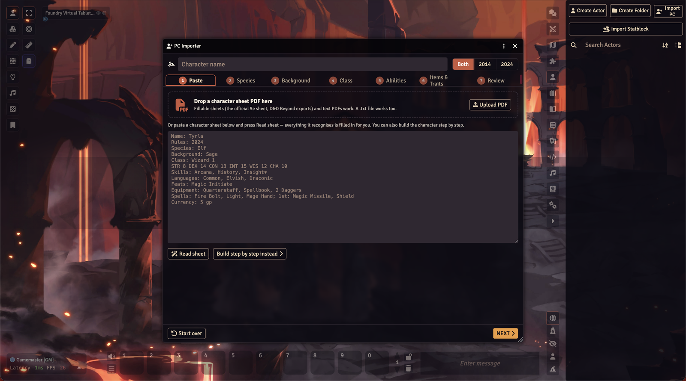
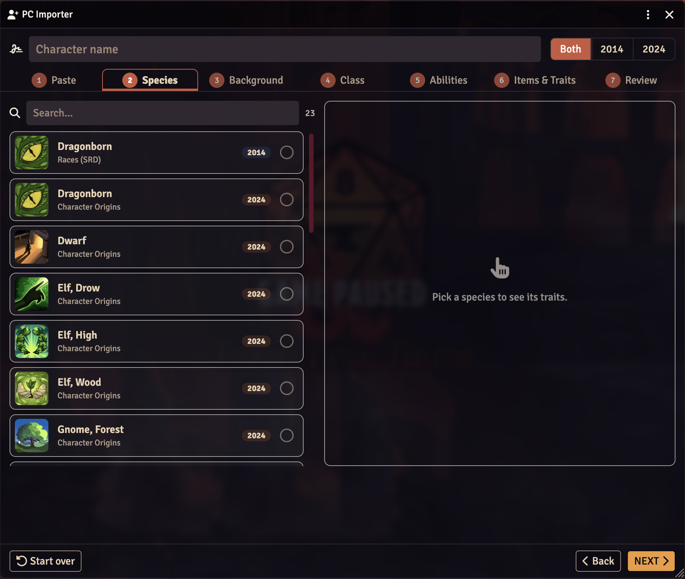
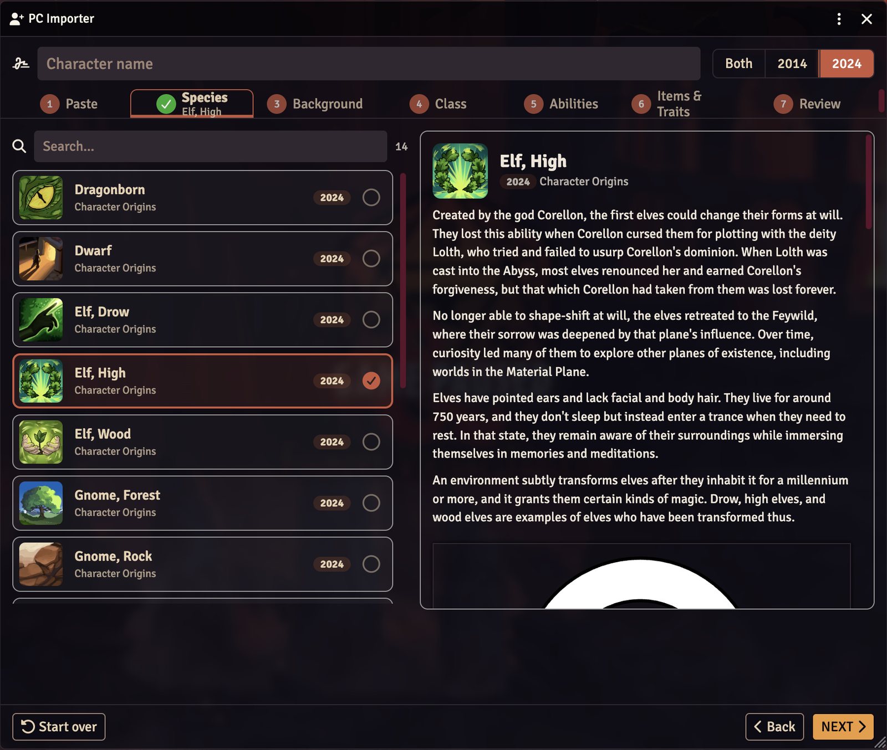
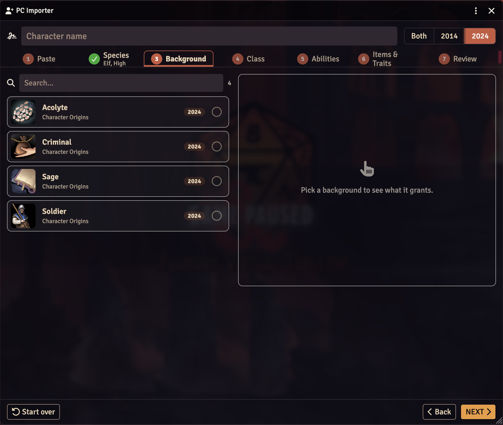
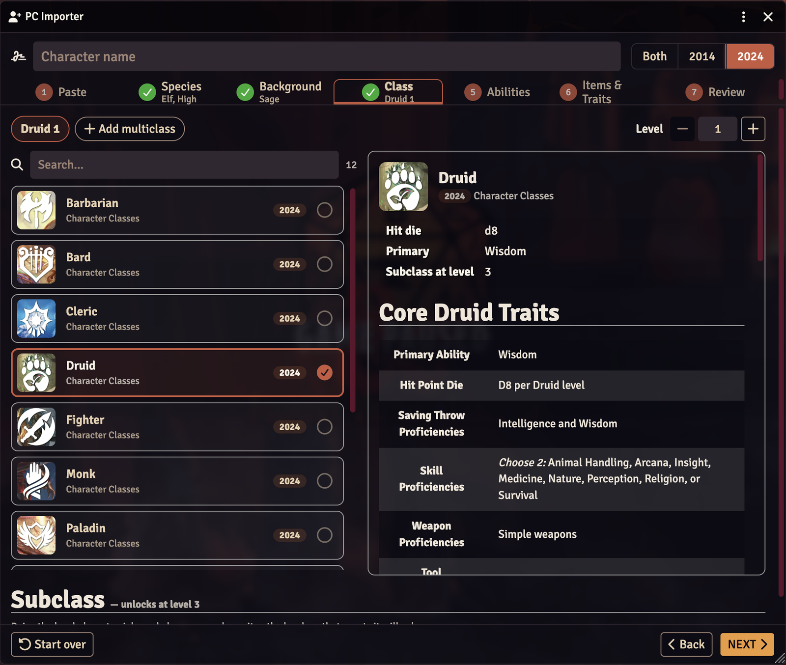
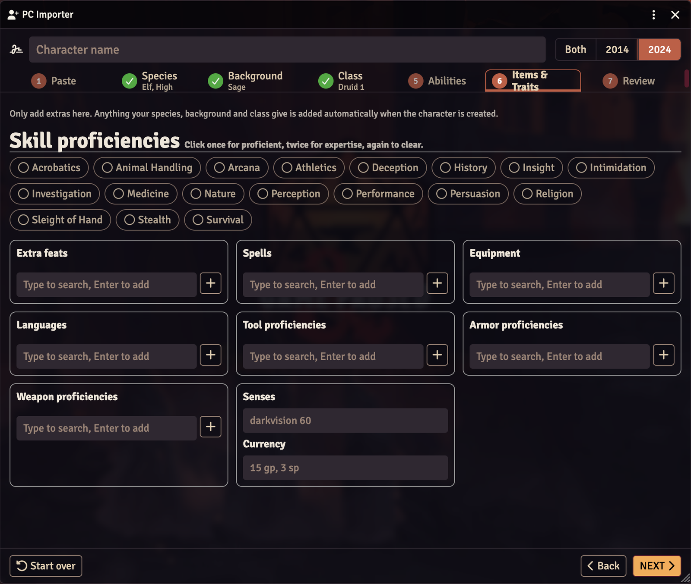
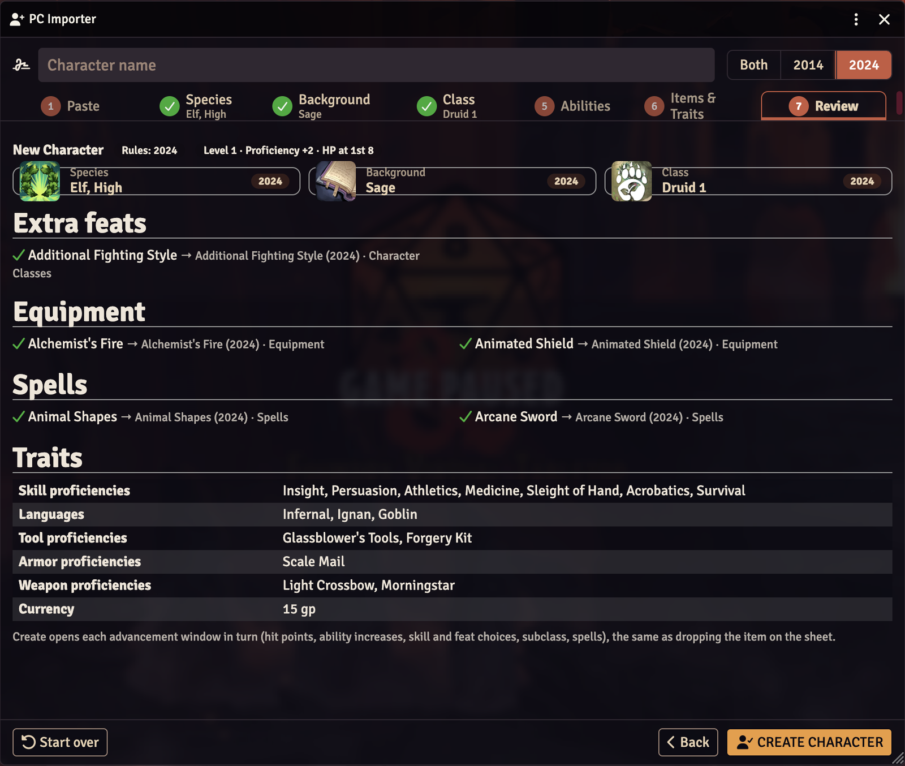
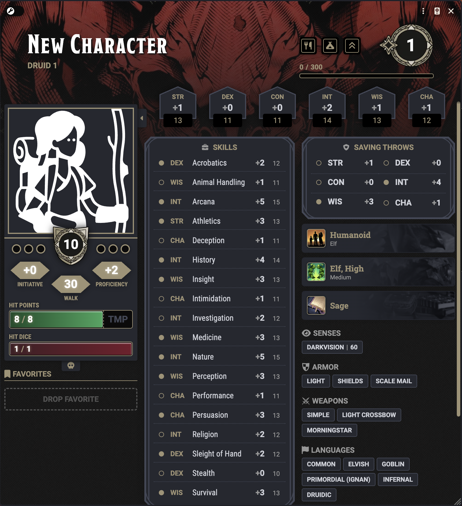

# PC 5/5.5e Importer

A Foundry VTT module for the D&D 5e system that **imports player characters** and **levels them up**. It brings in only what makes up the PC — species, background, class, subclass, feats, equipment, spells and traits (skills, expertise, languages, tools, armor and weapon proficiencies, senses, currency). Nothing else.

Works with **2014 (5e)** and **2024 (5.5e)** content, using the classes, species and backgrounds already in your world (the D&D 5e system's own content plus any homebrew you have). It doesn't add any compendiums.

## Screenshots

**Import PC opens the importer — drop a PDF, paste a sheet, or build step by step**



**Pick a species from a searchable list, filtered by Both / 2014 / 2024**



**The chosen option's full description appears beside the list**



**Backgrounds work the same way**



**Class: level stepper, multiclass slots, class details and subclass**



**Items & Traits: click skills; type to add feats, spells, gear and proficiencies**



**Review everything before creating the character**



**The finished character, built through the dnd5e advancement flow**



## Features

**Import a PC** — the *Import PC* button at the top of the Actors sidebar opens a step-by-step window. Your character's name and the rules switch (**Both / 2014 / 2024**) sit at the top; each step shows what you picked.

1. **Paste / Upload** — drop a character-sheet **PDF** (or press *Upload PDF*), or paste a sheet and press *Read sheet*, to fill everything in. Or build step by step.
2. **Species** · 3. **Background** · 4. **Class** — click an option in the list (search box on top, each row shows the source and a 2014/2024 badge) and its full description appears beside it. On Class, set the level with +/−, add multiclass slots, and pick a subclass once the class reaches the level that grants it (subclasses are matched to the class's rules version).
5. **Abilities** — Standard Array (picking a value swaps it with the ability that had it), Point Buy with +/− and a points counter, or Manual. Your class's primary abilities are starred.
6. **Items & Traits** — click skills once for proficient, twice for expertise. Feats, spells, equipment, languages, tools, armor and weapons: type to search and press Enter to add a chip; × removes it.
7. **Review** — everything that will be created, what was found where, and what becomes a placeholder. Click a card to jump back and change it.

*Create character* then runs the dnd5e advancement flow for each item in order — species → background → class → subclass → feats — so hit points, ability increases, skill and feat choices, subclass picks and spells follow each item's own rules, the same as dropping it on a sheet.

**Level up** — a ⏫ button appears next to the short/long rest buttons on every character sheet (also in the sheet's header menu). Level an existing class or multiclass into a new one, with a preview of character level, proficiency bonus, hit die, average HP and ASI levels, plus multiclass ability-requirement warnings.

## PDF character sheets

Drop a PDF on the Paste step or press **Upload PDF**. It's read inside Foundry — nothing is sent anywhere.

- **Fillable sheets** — the official 5e character sheet, D&D Beyond PDF exports and most form-fillable sheets are read from their form fields: name, species, background, class & level, ability scores, skills and expertise (D&D Beyond), proficiencies and languages, senses, feats, equipment with quantities, spells and coins.
- **Text PDFs** — anything else with selectable text is read line by line, using the paste format below.
- **Scans / photos** have no text to read; type or paste those instead.

The text read from the PDF is put in the paste box so you can check or fix it and press *Read sheet* again. If a sheet just says "Elf" and your world has several elf species, you'll be asked to pick one. A species that only exists in one ruleset (e.g. Half-Orc, 2014) makes the rest of that sheet use the same rules.

PDF reading uses [pdf.js](https://github.com/mozilla/pdf.js) by Mozilla (Apache 2.0), bundled in `lib/pdfjs`.

## Paste format

Labelled lines, in any order. Lines without a label continue the previous section.

```
Name: Tyrla
Rules: 2024
Species: Elf
Background: Sage
Class: Wizard 3 (School of Evocation)
STR 8 DEX 14 CON 13 INT 15 WIS 12 CHA 10
Skills: Arcana, History, Insight*        (* = expertise)
Languages: Common, Elvish, Draconic
Tools: Calligrapher's Supplies
Senses: Darkvision 60
Feats: Magic Initiate
Equipment: Quarterstaff, Spellbook, 2 Daggers, Rope x1
Spells:
Cantrips: Fire Bolt, Light, Mage Hand
1st: Magic Missile, Shield
Currency: 15 gp, 3 sp
```

Multiclass: `Class: Fighter 3 / Wizard (Evocation) 2`. Pasted ability scores are treated as final scores.

## Settings

- **Create placeholders for unknown items** — keep unmatched items/feats/spells as blank items so nothing is lost.
- **Players can import** — show *Import PC* to players allowed to create actors.
- **Level Up button** — show the button on character sheets.

## API

```js
PCImporter.openWizard({ initialName: "Tyrla" });
PCImporter.importFromText(text);     // opens the wizard pre-filled from pasted text
PCImporter.openLevelUp(actor);
PCImporter.parseCharacter(text);     // returns the parsed build object
```

## Install

Manifest URL:

```
https://github.com/siller94-art/pc-5e-importer/releases/latest/download/module.json
```

Requires Foundry VTT v14 and dnd5e 5.3+.
